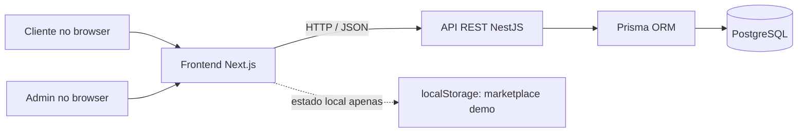

# Decisões arquitecturais — Lava Já Smart

Este documento explica a organização técnica adoptada para o protótipo e as consequências dessas escolhas. O sistema está focado num único carwash, na Matola, e numa demonstração funcional do percurso do cliente e da operação.

## Visão geral

O projecto está organizado como uma aplicação web e uma API no mesmo repositório:

- **Frontend:** Next.js, React e TypeScript em `src/`. Cada rota em `src/app/` corresponde a um ecrã; os componentes em `src/components/` concentram os fluxos interactivos.
- **Backend:** NestJS em `apps/api/`, organizado por módulos de domínio: marcações, serviços, autenticação, carteira, pagamentos, notificações, guia local e contas de cliente.
- **Persistência:** PostgreSQL é a fonte de verdade dos fluxos operacionais e demonstrativos servidos pela API. Prisma define o modelo, gera o cliente de acesso e aplica alterações através de migrações.
- **Marketplace de apresentação:** `/marketplace` é uma excepção deliberada: as ofertas são exemplos fixos e os pedidos de demonstração ficam no `localStorage` do browser. Não existe uma API nem persistência partilhada para esse fluxo.

## Decisões e motivos

### Uma aplicação por camadas, sem microserviços

Frontend, API e base de dados têm responsabilidades distintas, mas são executados como uma solução pequena e integrada. Para o âmbito actual — um carwash e um administrador — esta estrutura facilita a demonstração e a manutenção sem criar serviços distribuídos, filas ou operação adicional antes de haver necessidade real.

**Consequência:** a API é o ponto central para validar regras e escrever dados; a interface não deve ser tratada como fonte de verdade. Marketplace é explicitamente apenas um protótipo local.

### API REST com NestJS

Os módulos agrupam rotas, validação e lógica por área de negócio. A API publica recursos sob `/api`, usa JSON, valida DTOs globalmente e limita CORS à origem configurada em `FRONTEND_URL`.

**Consequência:** validações importantes, transições de estado e operações de saldo devem ocorrer no servidor, independentemente do que a interface apresenta.

### PostgreSQL e Prisma

PostgreSQL foi escolhido para manter marcações, clientes, viaturas, pagamentos registados, saldos demonstrativos, movimentos, notificações e auditoria num armazenamento relacional. Relações e restrições únicas ajudam a impedir, por exemplo, mais de um pagamento registado ou avaliação por marcação. Migrações Prisma documentam a evolução do esquema.

**Consequência:** alterações ao modelo de dados exigem migração e regeneração do cliente Prisma; dados operacionais não dependem da sessão do browser.

### Um domínio operacional: um carwash

O catálogo, os horários e as marcações pertencem ao Lava Já. A plataforma não gere vários carwashes, franquias ou parceiros como contas independentes.

**Consequência:** a conta empresarial existente representa um cliente que pode gerir uma frota, sujeita à aprovação do ADMIN. Não é uma conta de proprietário de marketplace nem de vendedor parceiro.

### Estados explícitos para marcações

Uma marcação evolui por estados controlados (`REQUESTED`, `ACCEPTED`, `IN_PROGRESS`, `COMPLETED`, entre outros). O servidor valida as transições e guarda eventos de estado para auditoria. Preço e duração são copiados para a marcação no momento da criação.

**Motivo:** manter o histórico coerente caso o catálogo seja alterado mais tarde e impedir que a interface declare como concluída uma operação não autorizada.

### Sessões separadas por tipo de conta

O ADMIN autentica-se pelo módulo da equipa. Clientes podem registar-se e entrar com telefone e palavra-passe; as palavras-passe são armazenadas como hash. Guardas e papéis protegem rotas administrativas, enquanto a autenticação de cliente restringe operações aos dados da própria conta. O registo empresarial fica pendente até revisão manual.

**Limite actual:** a verificação por OTP e recuperação de palavra-passe não estão implementadas; não há papéis de vendedor parceiro ou funcionário operacional com permissões específicas para além do escopo actual.

### Carteira demonstrativa e movimentos auditáveis

Os saldos carregado, promocional e bónus Moza são mantidos separadamente. Pontos também são uma unidade independente. Os movimentos guardam a origem e a descrição; chaves de idempotência reduzem duplicações em pedidos repetidos. Uma recompensa de pontos gera um registo de resgate.

**Motivo:** deixar visível, na demonstração, a diferença entre crédito de carteira e fidelização.

**Limite actual:** não há dinheiro real, carregamento efectivo, liquidação bancária nem parceiros a aceitar os vouchers.

### Checkout Moza em modo de apresentação

O checkout demonstra a criação de um pedido pendente associado a uma marcação e a validação posterior pelo ADMIN. O estado confirmado é uma acção interna de demonstração.

**Limite actual:** não há ligação ao Moza Banco, SIMO, POS, USSD, webhook ou confirmação de titularidade. A aplicação não deve apresentar esta confirmação como confirmação do banco.

### Notificações persistidas na aplicação

Notificações de marcação e campanhas ficam na base de dados e são consultadas na caixa de entrada da aplicação. O ADMIN pode agendar promoções; não é necessário depender de um fornecedor externo para demonstrar esse percurso.

**Limite actual:** não são enviados SMS, email ou push de sistema. As campanhas não equivalem a uma plataforma de marketing com consentimento e segmentação avançados.

### Marketplace local para demonstrar o conceito

O cliente vê ofertas ilustrativas e submete um pedido; o ADMIN pode aprovar ou rejeitar. O estado fica no armazenamento do navegador e só é partilhado quando as duas áreas usam o mesmo browser/perfil.

**Motivo:** tornar apresentável o percurso proposto sem insinuar que existem parceiros ou integração comercial.

**Limites actuais:** ofertas fixas, sem cadastro de parceiro, sem API, sem desconto de pontos, sem voucher utilizável e sem sincronização entre dispositivos.

### PWA com cache conservadora

A aplicação tem manifesto, recursos de instalação e fallback offline. O service worker limita a cache a recursos estáticos públicos e à página offline; páginas da aplicação e respostas da API não são guardadas em cache.

**Motivo:** oferecer uma base instalável sem conservar dados pessoais ou estados de conta numa cache offline.

## Onde encontrar cada decisão no repositório

| Área | Localização |
|---|---|
| Rotas e ecrãs web | `src/app/` |
| Componentes de cliente e administração | `src/components/` |
| Módulos da API | `apps/api/src/` |
| Modelo de dados | `apps/api/prisma/schema.prisma` |
| Histórico de alterações ao banco | `apps/api/prisma/migrations/` |
| Serviços locais de desenvolvimento | `docker-compose.yml` e `.env.example` |
| Regras e limitações do produto | `RESUMO_IMPLEMENTACAO.md` |

## Evolução quando houver integrações reais

Antes de activar dinheiro, mensagens ou parceiros reais, será necessário escolher os fornecedores e contratos, obter credenciais de ambiente de testes, definir verificação de callbacks e reconciliação, rever segurança e privacidade, e substituir as simulações por integrações verificáveis. A arquitectura actual separa os módulos por domínio para permitir essa evolução sem afirmar que ela já ocorreu.
