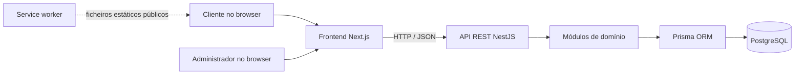
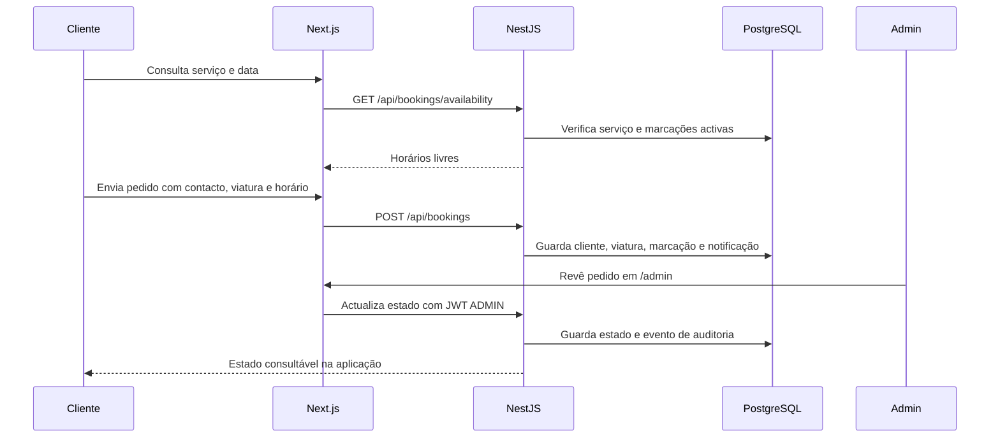

# Lava Já Smart

Plataforma web demonstrativa para o Lava Já, um único carwash na Matola. O sistema cobre a experiência de marcação do cliente e as tarefas de gestão do administrador, com dados operacionais guardados numa API e numa base de dados PostgreSQL.

> **Âmbito da demonstração:** o checkout Moza, os saldos de carteira, os pontos e os pagamentos apresentados são simulados. Não existe ligação ao Moza Banco, SIMO, POS ou USSD, nem movimento de dinheiro real. As notificações são mostradas dentro da aplicação; não são enviadas por SMS, email ou push.

## O que está disponível

### Para clientes

- Consultar o catálogo e criar um pedido de pré-marcação para um serviço, data e horário disponível. O atendimento decorre entre as 08:00 e as 18:00, em intervalos de 30 minutos, sujeito à duração do serviço e às marcações existentes.
- Acompanhar uma marcação e consultar o histórico com o código do pedido e o contacto telefónico, ou através de uma conta autenticada.
- Criar uma conta individual ou empresarial. As contas empresariais aguardam aprovação do administrador e, depois de activadas, podem gerir viaturas da frota.
- Consultar notificações internas sobre marcações, lembretes e campanhas promocionais agendadas pelo administrador.
- Avaliar uma marcação concluída com uma classificação de 1 a 5 e comentário opcional.
- Consultar o cartão virtual com QR de identificação. O QR não autoriza pagamentos.
- Explorar sugestões ilustrativas de serviços locais. Não representam parceiros confirmados.
- Consultar a carteira e a fidelização demonstrativas, com saldo carregado, créditos promocionais, bónus Moza e pontos apresentados separadamente.

### Para o administrador

Na área `/admin`, o administrador autenticado pode gerir o catálogo, rever e actualizar marcações, registar recebimentos declarados pela equipa, aprovar contas empresariais, editar sugestões locais, agendar campanhas e consultar indicadores operacionais e avaliações. Depois de aprovada, a conta empresarial pode gerir a própria frota.

As transições de estado das marcações ficam registadas para consulta. O registo de um recebimento representa uma confirmação manual da equipa; não processa nem confirma uma transacção bancária.

## Páginas principais

| Caminho | Conteúdo |
| --- | --- |
| `/` | Página inicial e catálogo de serviços |
| `/marcacoes` | Criar uma pré-marcação |
| `/marcacoes/historico` | Histórico e avaliação de serviços concluídos |
| `/fila` | Consultar o estado de uma marcação |
| `/perfil` | Registo, início de sessão e perfil de cliente |
| `/notificacoes` | Caixa de notificações na aplicação |
| `/cartao` | Cartão virtual de identificação |
| `/credito` | Carteira demonstrativa e movimentos |
| `/fidelizacao` | Pontos e recompensas demonstrativas |
| `/pagamento` | Fluxo demonstrativo de checkout Moza |
| `/servicos-locais` | Sugestões locais ilustrativas |
| `/admin` | Gestão e indicadores para o administrador |

Os caminhos antigos `/ao-redor` e `/marketplace` redireccionam para `/servicos-locais`. Não existe actualmente um marketplace operacional nem uma rede de parceiros integrada.

## Arquitectura

O projecto usa uma arquitectura em camadas num único repositório: a interface web apresenta os fluxos, a API aplica as regras de negócio e o PostgreSQL guarda os dados. Frontend e API são processos separados durante o desenvolvimento, mas não são microserviços distribuídos.



### Responsabilidades por camada

1. **Interface (`src/`)** — as rotas de `src/app/` montam as páginas. Componentes em `src/components/` tratam formulários, interacções e chamadas à API. O frontend não é a fonte oficial de estado de marcações, pagamentos ou saldos.
2. **API (`apps/api/src/`)** — os controllers recebem pedidos HTTP, os DTOs validam os dados e os services aplicam regras do domínio. A API publica os recursos sob o prefixo `/api`.
3. **Persistência (`apps/api/prisma/`)** — o schema Prisma descreve os modelos; as migrações versionam alterações ao PostgreSQL. Os dados operacionais não dependem do armazenamento do browser.
4. **Serviços locais de desenvolvimento** — `docker-compose.yml` inicia apenas a base de dados. Frontend e API são iniciados com os comandos npm indicados acima.

### Módulos do backend

| Módulo | Responsabilidade principal |
| --- | --- |
| `services` | Catálogo público e gestão administrativa dos serviços |
| `bookings` | Disponibilidade, pedidos, consulta, estados, estatísticas e auditoria |
| `customer-auth` | Contas de cliente, contas empresariais, frota, avaliações e operações de carteira associadas à conta |
| `auth` | Início de sessão da equipa e emissão/validação de JWT |
| `payments` | Registo manual de recebimentos e fluxo de pedido Moza demonstrativo |
| `wallet` | Saldos, movimentos, pagamentos de demonstração, pontos e resgates |
| `notifications` | Caixa interna, campanhas promocionais agendadas e processamento de campanhas vencidas |
| `local-guide` | Sugestões de serviços locais e respectiva gestão |
| `prisma` | Ligação partilhada à base de dados |

### Persistência e principais entidades

O schema em `apps/api/prisma/schema.prisma` organiza os dados em entidades relacionais:

- **StaffUser** guarda a conta da equipa. O âmbito actual prevê o papel `ADMIN`.
- **Customer** representa clientes individuais ou empresariais; **Vehicle** guarda as viaturas associadas.
- **Service** define nome, descrição, preço indicativo, duração e estado de publicação.
- **Booking** liga cliente, viatura e serviço, guarda o horário e copia preço/duração no momento do pedido. **BookingStatusEvent** regista transições administrativas; **BookingRating** guarda a avaliação do atendimento.
- **RecordedPayment** regista o método e o estado atribuído pela equipa no fluxo manual/demonstrativo.
- **DemoWallet**, **DemoMovement** e **RewardRedemption** mantêm os diferentes saldos, o histórico de movimentos e os resgates fictícios.
- **CustomerNotification** e **PromotionCampaign** guardam notificações e campanhas da caixa interna.
- **LocalPlace** guarda as sugestões locais mostradas ao cliente.

### Percurso dos dados



Na criação, a API verifica novamente a validade do horário e os conflitos de marcações. A disponibilidade exibida é uma consulta, não uma reserva temporária: outro pedido pode ocupar o horário antes do envio, caso em que o cliente deve escolher outro.

### Estados, pagamentos e fidelização

- Um pedido entra como `REQUESTED`. A equipa pode aceitá-lo ou rejeitá-lo; os pedidos aceites podem avançar para `IN_PROGRESS` e depois `COMPLETED`.
- A duração do serviço, o horário de funcionamento (08:00–18:00) e os intervalos de 30 minutos determinam os horários disponíveis. Marcações activas bloqueiam intervalos sobrepostos.
- O pagamento pela carteira e o pedido Moza são fluxos de demonstração. Pagamentos elegíveis só estão disponíveis depois da aceitação ou conclusão da marcação.
- Os pontos de fidelização são concedidos quando a marcação está concluída e o pagamento foi registado/confirmado no sistema. O bónus Moza é igualmente demonstrativo.
- Uma campanha promocional fica agendada na base de dados. Enquanto a API está activa, um processo interno verifica campanhas vencidas a cada 30 segundos e cria notificações na caixa dos clientes. Não há fornecedor externo nem serviço de filas separado.

## Acesso e validação

- A área de administração exige JWT com papel `ADMIN`; os endpoints de gestão aplicam guards no backend, não apenas na interface.
- Clientes podem usar consulta por código da marcação e telefone ou autenticar-se com telefone e palavra-passe. As palavras-passe são armazenadas como hash.
- Contas empresariais começam pendentes e só podem usar as operações empresariais depois da aprovação administrativa. As operações autenticadas ficam limitadas à conta do cliente.
- A API usa validação global de DTOs, remove campos não declarados e rejeita propriedades não permitidas. Os campos enviados pelo frontend não substituem estas validações.
- O service worker serve recursos estáticos públicos e o fallback offline. Não guarda respostas da API, páginas autenticadas ou dados de clientes.

## Organização do repositório

```text
src/
  app/                 Rotas e páginas Next.js
  components/          Fluxos interactivos de cliente e administração
apps/api/
  src/                 Módulos, controllers, DTOs e regras do backend
  prisma/
    schema.prisma      Modelo relacional
    migrations/        Histórico de alterações ao banco
    seed.ts            Dados para a demonstração local
public/
  brand/               Logótipos
  icons/               Ícones da PWA
  sw.js                Cache limitada a recursos públicos
docker-compose.yml     PostgreSQL local
.env.example           Configuração de desenvolvimento de referência
```


## Tecnologias

- **Frontend:** Next.js, React, TypeScript e Tailwind CSS (`src/`).
- **API:** NestJS com endpoints REST, validação de pedidos e Prisma (`apps/api/`).
- **Base de dados:** PostgreSQL 16, executado localmente com Docker Compose.
- **PWA:** manifesto, ícones, instruções de instalação e página offline. O service worker guarda apenas recursos públicos estáticos; não coloca dados da API em cache.
- **Idioma e formatação:** português de Moçambique (`pt-MZ`) e fuso horário `Africa/Maputo`.

## Requisitos

- Node.js 22.12 ou superior.
- npm.
- Docker com Docker Compose.

## Executar localmente

Na raiz do repositório, crie o ficheiro de ambiente a partir do exemplo e instale as dependências:

```bash
cp .env.example .env
npm install
npm --prefix apps/api install
```

Confirme no `.env` que `DATABASE_URL`, `JWT_SECRET`, `ADMIN_EMAIL` e `ADMIN_PASSWORD` estão definidos. A palavra-passe do administrador deve ter pelo menos 12 caracteres. Os valores do `.env.example` servem apenas para desenvolvimento local.

Inicie a base de dados e prepare a aplicação com os dados de demonstração. O comando `api:prisma:seed` aplica as migrações e gera o cliente Prisma antes de carregar o seed:

```bash
npm run db:up
npm run api:prisma:seed
```

Inicie a API num terminal:

```bash
npm run dev:api
```

Inicie o frontend noutro terminal:

```bash
npm run dev
```

Abra <http://localhost:3000>. A API fica em <http://localhost:4000/api> e o estado da ligação à base de dados pode ser consultado em <http://localhost:4000/api/health>.

O seed cria ou actualiza o administrador, os serviços e os dados usados na demonstração. `ADMIN_EMAIL` e `ADMIN_PASSWORD` são lidos do `.env`; altere-os antes de expor o ambiente fora da máquina local. Os dados semeados são de exemplo e não devem ser tratados como dados reais de clientes ou preços comerciais.

### Variáveis de ambiente

As variáveis e os valores locais de referência estão documentados em [`.env.example`](.env.example):

- `DATABASE_URL`: ligação PostgreSQL usada pela API e Prisma.
- `API_PORT`: porta da API (por omissão, `4000`).
- `FRONTEND_URL`: origem autorizada para pedidos CORS.
- `JWT_SECRET`: segredo usado para assinar tokens da equipa e dos clientes.
- `ADMIN_EMAIL` e `ADMIN_PASSWORD`: conta criada pelo seed.
- `NEXT_PUBLIC_API_URL`: endereço da API usado pelo browser.
- `API_URL`: endereço da API usado pelo Next.js no servidor.
- `POSTGRES_DB`, `POSTGRES_USER`, `POSTGRES_PASSWORD` e `POSTGRES_PORT`: configuração do container PostgreSQL.

### Comandos úteis

```bash
npm run api:build   # compilar a API
npm run build       # compilar o frontend
npm run lint        # executar ESLint no frontend
npm run db:down     # parar os serviços do Docker Compose
```

O service worker não é registado durante `next dev`. Para verificar a PWA, execute `npm run build` e `npm run start` e abra a aplicação em localhost.

### Resolução de problemas de arranque

- **`JWT_SECRET` não existe:** confirme que há um ficheiro `.env` na raiz e que contém essa variável. Reinicie a API depois de a alterar.
- **Erro de ligação à base de dados:** verifique `docker compose ps`, aguarde até o container `database` ficar saudável e confirme que a porta em `DATABASE_URL` corresponde a `POSTGRES_PORT` (por omissão `5433`).
- **A API inicia, mas a página não carrega dados:** confirme que `NEXT_PUBLIC_API_URL` aponta para a API acessível pelo browser e que `API_URL` aponta para a API acessível pelo processo Next.js. Em desenvolvimento local, ambos usam `http://localhost:4000`.
- **A porta já está ocupada:** altere `API_PORT`, `POSTGRES_PORT` ou a porta do Next conforme necessário e actualize as URLs dependentes no `.env`.
- **Alterou o schema Prisma:** aplique a migração adequada e regenere o cliente Prisma antes de iniciar a API. Para preparar a demonstração local, `npm run api:prisma:seed` aplica migrações e gera o cliente.

## Limites e trabalho futuro

- Integração real com Moza Banco, SIMO, POS ou USSD, incluindo confirmação e reconciliação de pagamentos.
- Envio de notificações por SMS, email ou push; actualmente a caixa de entrada é interna à aplicação.
- Marketplace com API, parceiros reais, vouchers resgatáveis e sincronização entre dispositivos.
- Verificação de telefone por OTP e recuperação de palavra-passe.
- Mais perfis e permissões para além do administrador e dos clientes; paginação também está adiada.
- Testes automatizados de API e testes ponta a ponta. Consulte o [plano de testes](PLANO_TESTES.md).

## Documentação

- [Decisões arquitecturais](DECISOES_ARQUITETURA.md)
- [Fluxos e roteiro de verificação](FLUXOS_E_ROTEIRO_VERIFICACAO.md)
- [Perguntas e respostas para a apresentação](PERGUNTAS_E_RESPOSTAS.md)
- [Resumo da implementação](RESUMO_IMPLEMENTACAO.md)
- [Plano de implementação](PLANO_IMPLEMENTACAO.md)
- [Plano de testes](PLANO_TESTES.md)
